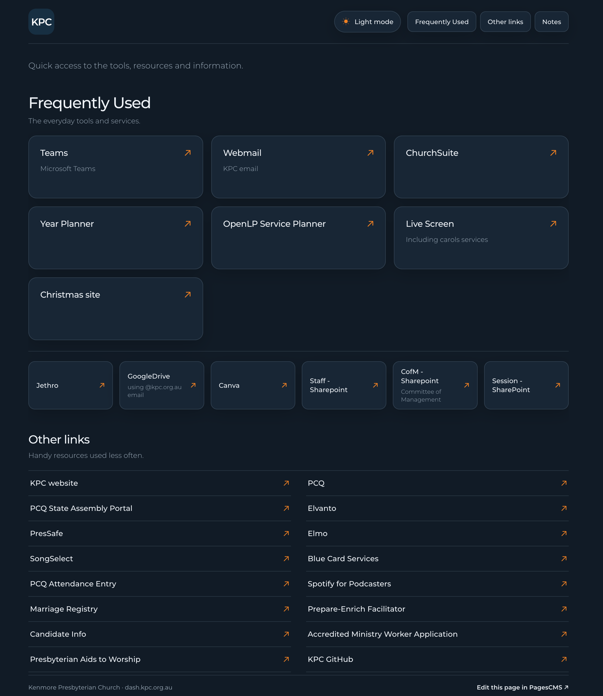

# Reusable Team Dashboard

A lightweight static dashboard for Cloudflare Pages. It provides editable link groups, notes, and organisation branding through PagesCMS. It contains example content only; replace the examples with your own links and information.

## PagesCMS sections

The editing menu is ordered as follows:

1. **Frequently Used Links - A list** – prominent large button cards.
2. **Frequently Used Links - B list** – smaller button cards with optional descriptions.
3. **Other links** – useful resources used less often.
4. **Notes** – reminders and team information.
5. **Branding & appearance** – upload separate light- and dark-mode logos, set the logo description and footer text, and customise colours.

## Branding

The dashboard starts in dark mode for first-time visitors. Visitors can switch between light and dark modes; their choice is remembered in their browser. Upload your organisation's logo(s) in **Branding & appearance** and set the footer text there too. The initial colours are neutral starter values and can be changed using six-digit HEX values.

Uploaded logos are stored in `media/` and served from `/media/`.

## Deploy

Commit the contents of this folder to your GitHub repository and connect the repository to Cloudflare Pages. The PagesCMS configuration is in `.pages.yml`.

## Example content

The three link collections each contain one `Example link` pointing to `https://example.com/`. The Notes section contains one example note. Replace or delete these in PagesCMS.

## Preview
Here is a screenshot of a real usage situation:

